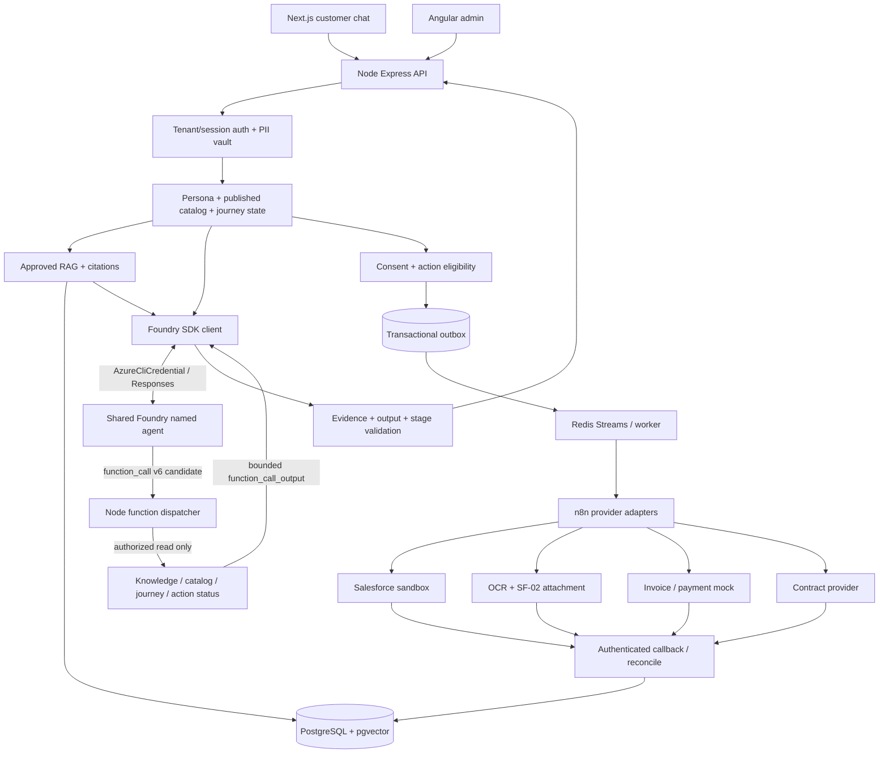

# Current architecture and trust boundaries

**Scope:** local Docker Foundry agent runtime and dedicated ANCFZ business-journey acceptance. Code is authoritative for implementation details; consult `current-requirements.md` and `verification/ancfz-single-journey-tool-calling.md` for what has and has not been verified.

## Runtime components

## Ownership of decisions

1. **Node authorization boundary:** binds tenant and customer session, masks PII, selects approved knowledge and catalog version. A Foundry conversation ID is private server state in `foundry_conversation_bindings`; the browser cannot choose it.
2. **Foundry:** produces conversational wording and may request strictly allowlisted read-only application functions. Version **v4** is stable serving, **v6** only explicitly invoked in isolated tests. An older v3 hosted OpenAPI dev tunnel is not trusted.
3. **Node dispatcher:** validates the `function_call`, derives tenant/session/opportunity exclusively from authenticated application context, authorizes and audits the result, and sends `function_call_output` using the matching call ID. No direct provider writes.
4. **Catalog and journey:** published pinned catalog defines requirements, eligible intents, workflow bindings and transitions; the model cannot grant eligibility or consent. Fact corrections, callbacks and concurrent turns use durable opportunity-scoped revisions.
5. **External execution:** Node action gateway → PostgreSQL transactional outbox → Redis Streams/worker → n8n → provider. Providers return authenticated correlation/evidence; n8n completion by itself does not mean Salesforce Account, payment or signed contract exists.
6. **Admin:** remains the existing authenticated Angular management API, not a direct Foundry administrative interface.

## Existing customer response contract

`POST /api/v1/chat/sessions` creates the authorized session; `POST /api/v1/chat/messages` returns the existing fields: `messageId`, `sessionId`, `answer`, `grounded`, `conversational`, `citations`, `actionProposal`, `pendingPromptId`, `pendingIntentKey`, `pendingRequirementKey`, `requestId`.

`answer` uses validated Foundry `output_text` when permitted. All other fields reflect server-side policy and persisted state. Do not return raw Foundry objects, tool calls or conversation IDs to clients.

## Data and retrieval boundary

Approved DOCX/XLSX/TXT/PDF/HTTPS/other explicitly supported sources pass through private staging, validation, Python extraction, PII/secret checks, review and embeddings to PostgreSQL pgvector. Source ACL, tenant, publication status, visibility and effective-date filters are applied before the model receives snippets. Customer-uploaded onboarding documents remain private transactional artifacts, **not** automatic RAG sources.

## Local and deployment boundaries

`docker-compose.yml` is the base stack; `docker-compose.foundry.local.yml` adds development-only Azure CLI to the API container with a private credential volume. No host Azure account cache or token should be copied into images or Git. Production authentication/deployment requires separate approval; local interactive CLI is not a production auth pattern.

## Verification boundary

Live v6 function-call/output and 13-turn single-journey tests have passed their focused assertions, but the latest run was stopped in Lead Generation because an external Salesforce Lead acknowledgment could not be verified. See `docs/verification/ancfz-stage-verification-matrix.md`. A conversation, local ActionRequest, n8n execution or mocked payment is not seven-stage completion.
