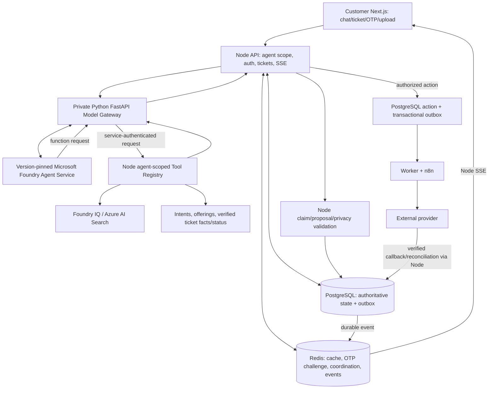

# 02 — Agent-centric system architecture

**Status:** target deployment, not current runtime.

## Logical flow

## Single ownership
- Foundry agent: natural reasoning, intent identification and function selection; not business authority.
- Python gateway: invoke Foundry, normalize turn, apply budgets, mediate ALL agent-called application functions. No LangGraph in target and no access to provider credentials other than its own approved Foundry identity.
- Node: trusted agent resolution, session/OTP/account ownership, tool ACL, request durability, response grounding, action consent, workflow policy and ticket closure.
- Foundry IQ: only approved agent-scoped business knowledge via gateway-mediated `search_knowledge`. No public-web knowledge sources.
- PostgreSQL: durable business/ticket/memory truth; Redis: cache and delivery; n8n: approved workflow transport. External providers never write DB directly.
- OCR: customer ticket attachments handled separately from published RAG, with source-linked structured facts and human confirmation as needed.

## One customer message
1. Node derives agent ID from trusted route/config; verifies ticket access; atomically accepts message and appends event using client-message idempotency.
2. Load pinned agent/persona/catalog/knowledge versions, facts, recent turns, durable summary and action status; rehydrate Redis cache by revision.
3. Python invokes Foundry; function calls are checked/forwarded to Node. Node executes authorized reads/preflight and returns bounded, provenance-aware outputs.
4. Foundry composes natural response; Node independently checks critical claims, candidate facts and action proposal; commit answer + ticket event; publish SSE.
5. Customer-approved side effect goes through separate Node action authorization, transactional outbox, worker/n8n and provider reconciliation; every state change appends ticket event.
6. Explicit customer request (not idle/farewell) closes ticket after reconciling in-flight operations.

## Reliability
PostgreSQL event IDs/sequences enable SSE `Last-Event-ID` replay; Redis loss must not lose accepted messages. Per-ticket concurrency uses session lease/queue or optimistic revision with deterministic retry. Unknown provider status is not success. No direct Python/Foundry knowledge or actions bypass Node. Screens and admin do not call internal gateway routes.

## Target containers
Ordinary PostgreSQL 16 (no pgvector), Redis, Node API, Python model gateway, Next.js web, Angular admin, n8n, Nginx, worker (outbox/reconciliation) and OCR worker if OCR runs asynchronously. One-shot schema and opt-in admin bootstrap. Remove only obsolete mock PDF/payment and embedding resources after dependency removal.
