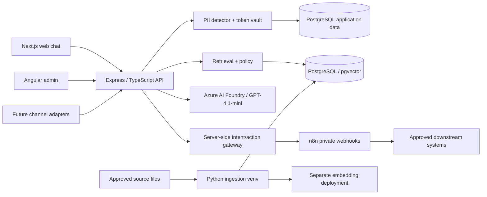

# Architecture and data flow

## Logical components

## Trust zones
1. **Untrusted edge**: web and future channels; all input considered adversarial. Channel authentication is required where a verified identity is claimed.
2. **Trusted application boundary**: Node validates channel scope, masks PII, manages conversation state and resolves user/tenant authorization. No unrestricted access to masking keys in other services.
3. **Business knowledge boundary**: files and vector chunks are *data*, never instructions. Apply tenant/source ACL before selecting context. Do not intermingle knowledge with customer identity.
4. **External processor boundary**: Azure AI Foundry receives only masked, minimal prompts and source excerpts permitted for model processing. n8n receives only approved action DTOs, not arbitrary transcripts.
5. **Protected data boundary**: PostgreSQL stores customer information and encrypted reversible mappings with separate roles, controls, audits and expiration.

## Web chat sequence
1. Browser opens session through Node; Node establishes tenant and channel context without trusting client-supplied tenant IDs.
2. Request is authenticated/rate-limited/validated; Node normalizes text and detects/masks customer identifiers.
3. Node stores scoped conversation state and masked turns. PII vault stores encrypted mappings separate from prompts and embeddings.
4. Node creates retrieval query from sanitized message; hybrid lexical/vector strategy may be used, always with SQL-level tenant/source/ACL filters.
5. Node assembles limited evidence snippets with document IDs, stable chunk IDs, page/section, version and source validity.
6. Node calls GPT-4.1-mini with policy, history and relevant snippets. Expected output includes answer, cited chunk IDs and a structured *intent proposal* when useful.
7. Node verifies evidence IDs against supplied snippets and enforces confidence/claim checks. Unknown facts are not filled in by the model.
8. Node checks action registry, user confirmation/consent, authorization and idempotency; it alone calls n8n over an authenticated private link.
9. Node validates workflow result, rehydrates only allowed approved tokens at the last delivery boundary, and responds to the same authorized recipient.
10. Node emits a redacted audit event and operational metrics. Workflow failures are not disguised as success.

## Ingestion sequence
Admin uploads/approves source → encrypted private staging → file validation/malware scan → safe content extraction → PII/secret scan → normalization → source metadata/versioning → deterministic chunks → embedding deployment → pgvector upsert → retrieval quality test → atomic active-version promotion. Failed uploads remain excluded from retrieval. Deleted/revoked sources must be removed or disabled from future search promptly.

## Deployment note
MVP can use a **single PostgreSQL service** with separate application and knowledge schemas/roles; pgvector is an extension on PostgreSQL. Separate clusters may be adopted if required by compliance or load. Existing docker-compose.yml only provisions n8n; it does *not* implement this architecture.

## Failure modes
- No matching authorized evidence → clearly say information is unavailable.
- Model unavailable/timeouts → safe error; do not silently substitute ungrounded canned company facts.
- Vector DB unavailable → explain temporary inability to verify.
- n8n timeout → report pending/unknown unless a durable verified result exists; retry with same idempotency key.
- Token vault unavailable → never expose raw tokens or hallucinated rehydration.
- Untrusted prompt injection from a document → treat as text, not instruction, and report suspicious content where appropriate.
