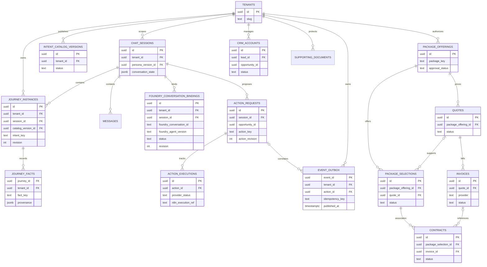

# Current PostgreSQL data model — tenant, Foundry and seven-stage journey

This diagram is a **logical map of implemented persistence**, not a substitute for the SQL schema. The authoritative definitions are the sequential migrations in `infra/postgres/`, especially `030-event-driven-execution.sql`, `044-journey-opportunity-identity.sql`, `047-business-lifecycle.sql` and `054-foundry-conversation-bindings.sql`. Not every logical opportunity association is declared as a foreign key; enforce tenant/opportunity scope in application transactions and existing constraints.

## Data ownership and compatibility

- **Tenant/session:** authenticated tenant scope controls all customer records. Session state pins the active persona/catalog context; client IDs and Foundry conversation IDs are not authorization tokens.
- **Foundry:** `foundry_conversation_bindings` stores server-owned tenant/session/agent/version mapping. Conversations support continuity, but business truth is stored in PostgreSQL, not the model.
- **Journey:** `journey_instances` and `journey_facts` represent opportunity identity, catalog revision and provenance. Existing `conversation_state.intentProgress` and scoped action mappings remain compatibility/read paths; do not assume every lifecycle stage is a separate physical table.
- **Actions/outbox:** `action_requests`, `event_outbox`, `event_inbox`, `action_executions` and Redis Streams provide durable, idempotent dispatch and callback reconciliation. Redis is delivery infrastructure, not truth.
- **Business lifecycle:** `crm_accounts`, `package_offerings`, `quotes`, `package_selections`, `supporting_documents`, `invoices` and `contracts` hold guarded business artifacts. External provider IDs and verified callbacks are required before claiming completion.
- **Knowledge/security:** source versions, pgvector chunks, ingestion jobs, token-vault mappings, role memberships and audit logs remain in existing tables not fully expanded in this diagram. Onboarding uploads must not become public RAG knowledge without approval.
- **Version migration:** applied migrations must never be deleted or rewritten to match a diagram. Schema constraints and actual service code take precedence over this documentation.

For behavior, see [current requirements](current-requirements.md), [journey orchestration](21-generic-journey-orchestration.md), and [Foundry local development](foundry-local-development.md).
