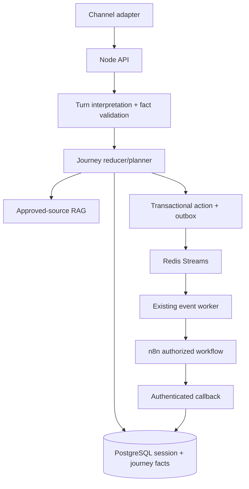

# Generic catalog-driven journey orchestration

The conversation remains tenant-bound and source-grounded, while business behavior comes from the published catalog. PostgreSQL is authoritative; Redis Streams and the existing worker deliver approved actions to n8n.



Sessions hold conversation state and compatibility projections. Each intent entry is an opportunity with its own `journeyId`, slots, provenance, requirements and revision. Actions use `(tenant, opportunity, actionKey, actionRevision)`; `workflowKey` only identifies the implementation and may be reused by another opportunity.

```mermaid
sequenceDiagram
  participant U as Visitor
  participant API as Node API
  participant DB as PostgreSQL
  participant RAG as Approved RAG
  participant N as n8n
  U->>API: message
  API->>DB: load session, pinned catalog, active journey
  API->>API: interpret turn, validate facts, plan next step
  alt information interruption
    API->>RAG: tenant/source filtered retrieval
    RAG-->>API: evidence + citations
    API-->>U: grounded answer; pending requirement preserved
  else actionable journey
    API->>DB: persist scoped facts and action/outbox atomically
    API-->>U: question or explicit consent control
    U->>API: consent
    API->>N: minimum-data authorized action contract
    N-->>API: authenticated completion callback
    API->>DB: validate identity and advance only that journey
  end
```

Journey entries are pinned to the catalog version selected when the journey starts. New catalog publications affect new journeys; existing journeys remain readable and deterministic. Legacy `slotValues` and actions remain as compatibility projections, while new writes use scoped entries and opportunity-aware action identity.

Consent remains purpose-scoped and RAG never authorizes actions. Documents, CRM writes, callbacks and workflow bindings continue to use the existing tenant and authorization gates. To add a tenant journey, publish catalog intents, requirements, validation rules, document/consent policies and an allowlisted workflow binding—no core code branch is required.

## Gap-to-fix traceability

| Requirement | Implementation |
| --- | --- |
| Shared workflow must not suppress a new opportunity | `journeyId`/`opportunityId`, action key/revision and partial unique index |
| Independent slot values | scoped `slotValues`/provenance on intent progress entries |
| Information interruption | pure `classifyTurn` and planner contract; reducer preserves pending requirement |
| Existing compatibility | nullable additive columns and legacy projections |
| Durable side effects | existing PostgreSQL outbox, Redis Streams, event worker and n8n callback path |

Run `npm run test`, `npm run typecheck`, `npm run lint`, `npm run build`, and `npm run verify:compose` before release.
