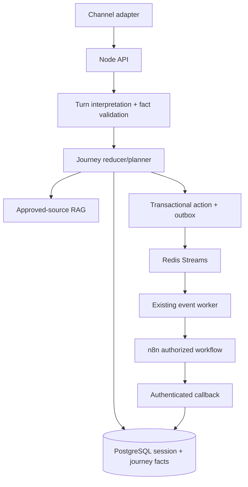

# Generic catalog-driven journey orchestration

The conversation remains tenant-bound and source-grounded, while business behavior comes from the published catalog. PostgreSQL is authoritative; Redis Streams and the existing worker deliver approved actions to n8n.



Sessions hold conversation state and compatibility projections. Each intent entry is an opportunity with its own `journeyId`, slots, provenance, requirements and revision. Actions use `(tenant, opportunity, actionKey, actionRevision)`; `workflowKey` only identifies the implementation and may be reused by another opportunity.

## Customer and asynchronous provider sequence

```mermaid
sequenceDiagram
  participant U as Visitor
  participant API as Node Chat API
  participant DB as PostgreSQL
  participant FA as Foundry agent
  participant REL as Outbox relay
  participant BUS as Redis Streams
  participant WORK as Event worker
  participant N as n8n / provider
  U->>API: customer message
  API->>DB: load authorized session + pinned catalog + journey
  API->>API: validate facts and next eligible requirement
  API->>FA: masked, bounded evidence + persona/context
  opt Foundry v6 candidate requests function
    FA-->>API: function_call + call_id
    API->>DB: trusted session-scoped read
    API-->>FA: function_call_output, matching call_id
  end
  FA-->>API: output_text
  API-->>U: existing Chat API response / actionProposal if eligible
  opt User explicitly confirms an eligible action
    U->>API: action confirmation
    API->>DB: verify consent, revision, idempotency; persist action and outbox atomically
    API-->>U: queued / pending, not provider completed
    REL->>DB: claim unpublished outbox event
    REL->>BUS: publish opaque event
    BUS->>WORK: deliver authorized event
    WORK->>N: authenticated minimum-data workflow
    N-->>API: authenticated verified provider callback
    API->>DB: reconcile external reference, advance matching opportunity only
  end
```

A knowledge interruption leaves the pending requirement intact. A CRM timeout or an unverified callback leaves the action pending/reconciliation-required instead of completing the journey. The former direct API→n8n and scheduled-claim diagrams are **legacy compatibility descriptions**, not the primary execution path.

Journey entries are pinned to the catalog version selected when the journey starts. New catalog publications affect new journeys; existing journeys remain readable and deterministic. Legacy `slotValues` and actions remain as compatibility projections, while new writes use scoped entries and opportunity-aware action identity.

Consent remains purpose-scoped and RAG never authorizes actions. Documents, CRM writes, callbacks and workflow bindings continue to use the existing tenant and authorization gates. To add a tenant journey, publish catalog intents, requirements, validation rules, document/consent policies and an allowlisted workflow binding—no core code branch is required.

## Gap-to-fix traceability

| Requirement | Implementation |
| --- | --- |
| Shared workflow must not suppress a new opportunity | `journeyId`/`opportunityId`, action key/revision and partial unique index |
| Independent slot values | scoped `slotValues`/provenance on intent progress entries |
| Information interruption | pure `classifyTurn` and planner contract; reducer preserves pending requirement |
| Existing compatibility | nullable additive columns and legacy projections |
| Durable side effects | existing PostgreSQL outbox, Redis Streams, event worker and n8n callback path |

Run `npm run test`, `npm run typecheck`, `npm run lint`, `npm run build`, and `npm run verify:compose` before release.
