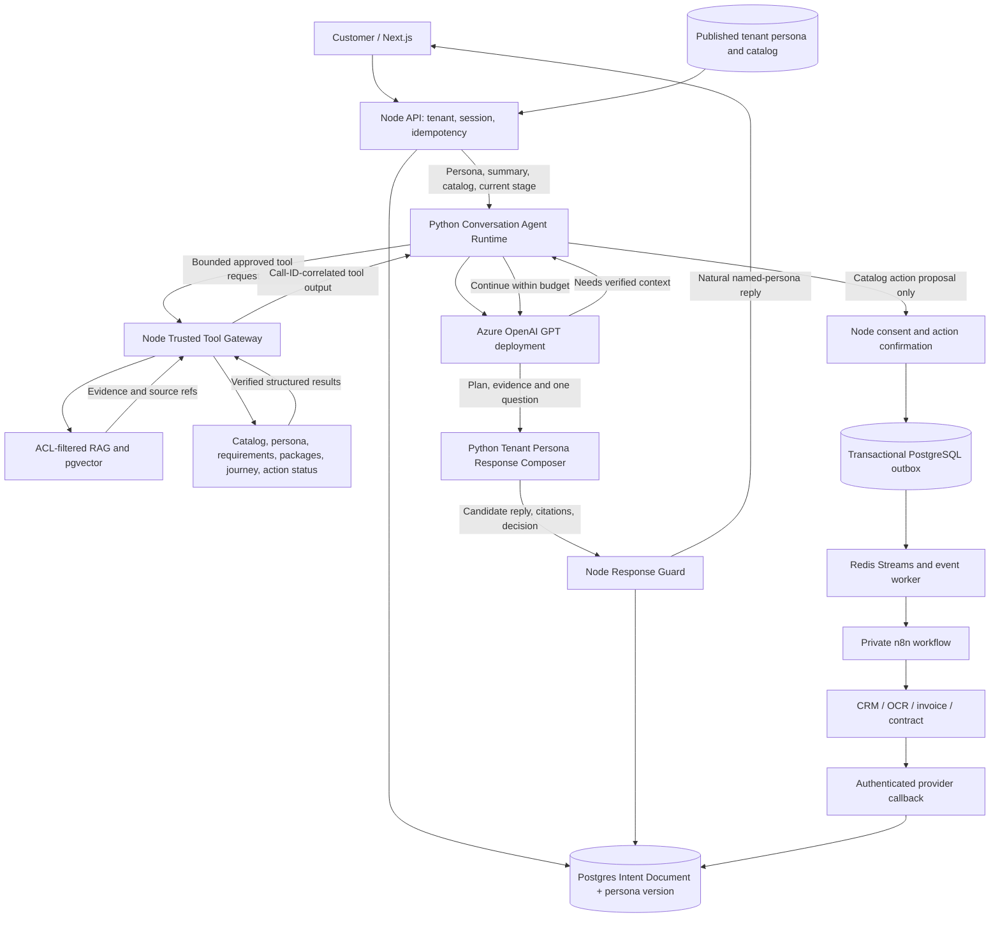

# Target solution architecture — Node orchestration + Python GPT model API

**Status: TARGET beyond existing scaffold.** The merged `main` contains an initial Python FastAPI gateway and Node adapter, while the monolithic Node chat handler still owns legacy conversation decisions; see `current-state.md`. This design uses a GPT **model deployment** (not saved Foundry Agent) with a private Python API. GPT is the **central dialogue strategist and intent planner**; Node remains the trusted validator and workflow executor. Distinguish persistent **Business Goal** from ephemeral **turn intent** and authorized **tool action**.

## End-to-end flow

**Persona-first agent loop:** Node preloads the published, session-pinned assistant identity and voice, current facts, catalog and goal. Python GPT can request authorized **Node read tools before responding**. The final message is composed as that tenant's assistant, then validated before reaching the customer.

**TARGET only:** current Python gateway/Node adapter are scaffolding. The complete tool-calling loop, Persona Response Composer and Node Response Guard have not been implemented. See [agent-tool-loop.md](agent-tool-loop.md) and [persona-response-contract.md](persona-response-contract.md).

## Trust and responsibilities

| Layer | Responsibilities | Must NOT do |
| --- | --- | --- |
| Browser/channel | Display grounded answer, follow-up and approved action confirmation | Choose tenant scope; call Python, Azure, DB or n8n directly |
| Node API | Verify tenant/catalog/**published persona version**, execute allowlisted read tools, validate plans, **guard all customer-visible replies**, persist intent, approve actions/callbacks and provide persona-specific fallback | Blindly trust model plans, return raw tools/JSON/errors, accept arbitrary catalog URLs or delegate action authority |
| Python Conversation Agent Runtime | Plan as the pinned tenant persona, choose clarification/tool lookups, request trusted Node tools before answering, and **compose a final natural persona-style reply** grounded in results | Write business state, select tenant/identity, hold DB/CRM credentials, directly invoke n8n or invent provider completion |
| PostgreSQL | Sessions, per-turn intent ledger, catalog, journey/opportunity state, action/outbox, source/versioned knowledge | Store unbounded raw provider traces without retention |
| Redis | Optional dedup cache + rate budget + event stream | Replace durable decision/confirmation state |
| n8n | Execute allowlisted, scoped provider operations using managed credentials, return correlation/evidence | Decide business rules or mark completion without provider proof |

## One-turn processing order

1. Node authenticates caller, loads pinned tenant catalog + User Intent Document, dedupes client message and constructs a bounded **conversation summary** of verified facts, answered topics, previous goal and pending requirement.
2. Node sends catalog-allowed **Business Goals, category taxonomy, phrase/keyword signal evidence, requirement/tool definitions** and the latest turn to Python's GPT **`/plan`** operation. The LLM recognizes turn category, weighs candidate goals, preserves or suggests goal change, identifies what is still missing, and **decides the next useful move**.
3. Node validates the LLM's proposed catalog keys, bounded weights, observed fact spans, confidence evidence, source authorization and stage dependencies. **Goal identification confidence**, **requirement coverage** and **action readiness** are separate; a high semantic score never authorizes workflow execution.
4. If the planner needs knowledge, normalize the query with bounded GPT task (where helpful), then retrieve approved tenant RAG evidence; compose a factual answer using only retrieved citations/verified provider data. Never let GPT invent package prices, fees or regulatory claims.
5. If the goal is unconfirmed, ask one natural customer confirmation/clarification. If confirmed, ask **one next high-information requirement** (fact, contact, document, or action confirmation) chosen by the LLM from **catalog-permitted options**. Answer interruptions and resume the goal instead of resetting it.
6. Node validates the final one-question answer and persists the accepted planner decision, summary revision, candidate evidence, normalized RAG tokens, factual updates, next question and output through a CAS-safe User Intent Document and turn audit.
7. When a catalog tool is eligible, Node obtains separate purpose-specific consent/action confirmation and uses PostgreSQL outbox → Redis → n8n. An async provider callback updates authoritative stage completion, not GPT text.
8. When a knowledge-only request is satisfied, offer more help without compulsory lead capture. When a **business goal** is fully complete per published catalog and provider evidence, summarize and ask if another service is needed.

The planner should be called for substantive new turns, with scoped caching to avoid redundant calls; duplicate `clientMessageId` always replays saved outcome without model calls. The LLM has **initiative over dialogue strategy**, but not authority to invent intents, bypass required consent or execute an unapproved tool.

## Mandatory final response boundary

**Before planning:** Node resolves the tenant's published persona/name/tone/AI disclosure/permitted language, `personaVersionId`, catalog, stage and verified facts. **During planning:** Python may request bounded Node read tools; RAG/tool outputs are trusted as data only after Node authorization and source checks. **After tool continuation:** Python's **Persona Response Composer is the last generative step**; it produces the customer answer in a natural, coherent named-persona voice, not raw planner or workflow data. **Before delivery:** Node Response Guard verifies persona/version, citations, action/state truth, one purposeful question or valid exception, language and non-disclosure of internal metadata.

If the model or a tool is unavailable, use a tenant-persona-versioned approved **offline template** with only verified facts. Do not require a functioning GPT call to generate an outage fallback. A generic transport error is permissible before tenant/session binding. Never use Zara as a hardcoded fallback for other tenants. The invariant covers all seven stages, knowledge-only visitors and failures.

## Durable conversation boundary

`tenant_id` → `session_id` → active `opportunity_id` → pinned `catalog_version_id` → **primary business goal** + **per-turn intent category**, LLM planner summary/weighted candidate assessments, verified facts, pending requirement/question, catalog tool proposals + action/callback revisions. The model's conversation state or its response id is not the authority. New business opportunities create new intent documents; historical intent documents remain readable under tenant ACL, not used as another opportunity's consent.

## Deployment

Development uses `docker-compose.yml` and `docker-compose.local-dev.yml`. Add a **private** Python model-gateway service, outbound HTTPS only to an approved Azure OpenAI endpoint. Node-to-Python private network authentication via bounded service credential/HMAC (or mTLS where configured), timeouts, no public port. API key only in gateway secret env or secret mount. Existing ingestion/PDF/payment Python services are separate processes and not to be confused with model gateway. Model deployment, provider, rate budget and persona are configuration; no tenant logic in Docker images.

## Cutover

The `CHAT_MODEL_PROVIDER=python-gpt` Node adapter is scaffolded as an opt-in service; implement the new conversation coordinator, bounded Node tool loop, persona composer and response guard before switching production traffic. Use Git history and a tested deployment rollback, not an assumed live Foundry adapter. Preserve published Chat API response shape, admin routes, outbox and data. Migrate/read existing session summaries and journey facts to the User Intent Document through audited additive schema migration. Test rollback before retiring old adapter. Full plan: `migration-plan.md`.
