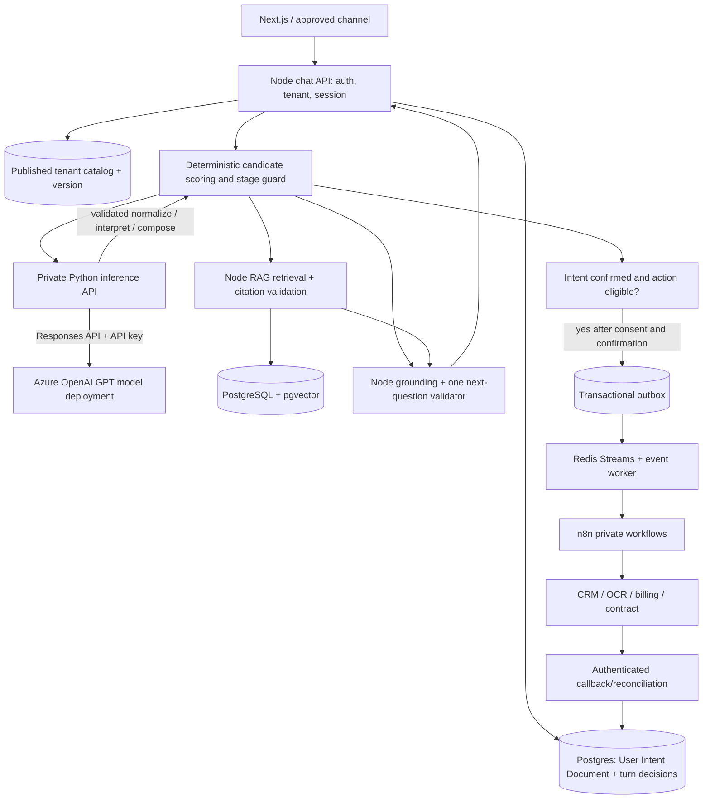

# Target solution architecture — Node orchestration + Python GPT model API

**Status: TARGET.** The current implementation still uses a Node-hosted named Foundry agent; see `current-state.md`. This architecture intentionally avoids the saved Foundry Agent while continuing to use a GPT model **deployment** in Azure OpenAI/Foundry Models.

## End-to-end flow

## Trust and responsibilities

| Layer | Responsibilities | Must NOT do |
| --- | --- | --- |
| Browser/channel | Display grounded answer, follow-up and approved action confirmation | Choose tenant scope; call Python, Azure, DB or n8n directly |
| Node API | Verify auth, determine tenant/catalog, orchestration, scoring, fact validation, source ACL, User Intent Document, consent, actions, callbacks | Blindly trust model confidence/intent/URL or publish secrets |
| Python Model Gateway | Stateless normalized query, structured interpretation/slot proposals, natural grounded answer; single GPT API-key client and retry policy | Write business state; hold customer DB credentials; dispatch n8n or choose tenant |
| PostgreSQL | Sessions, per-turn intent ledger, catalog, journey/opportunity state, action/outbox, source/versioned knowledge | Store unbounded raw provider traces without retention |
| Redis | Optional dedup cache + rate budget + event stream | Replace durable decision/confirmation state |
| n8n | Execute allowlisted, scoped provider operations using managed credentials, return correlation/evidence | Decide business rules or mark completion without provider proof |

## One-turn processing order

1. Authenticate request and bind tenant, session, active opportunity and pinned catalog revision; dedupe message by client idempotency key before calls.
2. Load User Intent Document, pending requirement, consent, prior fact provenance and any stored per-turn decision.
3. Deterministic phrase/keyword/exclusion candidate retrieval **from the tenant catalog**. Only call Python `/interpret` when a candidate/slot ambiguity or useful semantic interpretation exists; do not waste a model call on an already-known context reply.
4. Normalize the latest query for retrieval (Python `/normalize` if needed; memoize by context/catalog hash). Node validates quantities/negation/intent tokens and builds tenant-filtered RAG query.
5. Retrieve approved pgvector evidence. Python `/compose` uses bounded evidence, persona, confirmed intent and pending requirement; Node validates citations/grounding and enforces **one next question** on a successful grounded active-journey turn.
6. Node persists normalized query, score breakdown, candidate revisions, primary/secondary intent decisions, last response and User Intent Document with CAS/optimistic revision and immutable turn audit.
7. If intent is unconfirmed, ask a single **intent confirmation** question before activating its requirements. If confirmed, ask one current catalog requirement; if action eligible, expose an action proposal and wait for separate user confirmation.
8. Any confirmed state-changing operation is transactional, outboxed and executed by worker/n8n; async callback advances only the correct stage/opportunity revision. User may ask grounded questions while action waits.

**Budget:** aim for 0 model calls on cached/replayed turns; 1 interpret/normalize call when needed and 1 compose call per new turn. Do not force additional calls if deterministic decisions are sufficient. If normalization and interpretation can be combined under one strict schema without losing quality, prefer that after measured tests.

## Durable conversation boundary

`tenant_id` → `session_id` → active `opportunity_id` → pinned `catalog_version_id` → `user_intent_document` + turn assessments + scoped journey facts + pending requirement + action/callback revisions. The model's conversation state or its response id is not the authority. New business opportunities create new intent documents; historical intent documents remain readable under tenant ACL, not used as another opportunity's consent.

## Deployment

Development uses `docker-compose.yml` and `docker-compose.local-dev.yml`. Add a **private** Python model-gateway service, outbound HTTPS only to an approved Azure OpenAI endpoint. Node-to-Python private network authentication via bounded service credential/HMAC (or mTLS where configured), timeouts, no public port. API key only in gateway secret env or secret mount. Existing ingestion/PDF/payment Python services are separate processes and not to be confused with model gateway. Model deployment, provider, rate budget and persona are configuration; no tenant logic in Docker images.

## Cutover

Implement a provider-neutral Node adapter (`CHAT_MODEL_PROVIDER=python-gpt` proposed) in parallel with the old Foundry adapter, using a feature flag or selected development environment. Preserve published Chat API response shape, admin routes, outbox and data. Migrate/read existing session summaries and journey facts to the User Intent Document through audited additive schema migration. Test rollback before retiring old adapter. Full plan: `migration-plan.md`.
