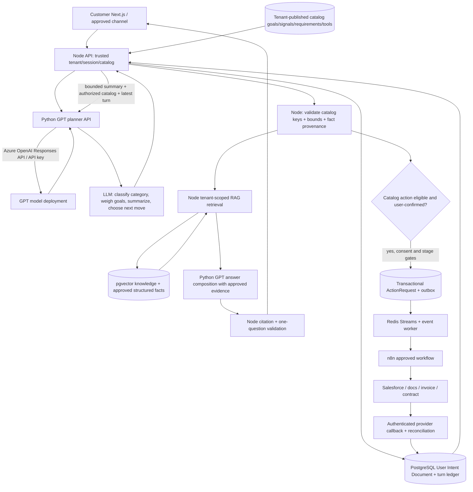

# Target solution architecture — Node orchestration + Python GPT model API

**Status: TARGET.** The current implementation still uses a Node-hosted named Foundry agent; see `current-state.md`. This design uses a GPT **model deployment** (not saved Foundry Agent) with a private Python API. GPT is the **central dialogue strategist and intent planner**; Node remains the trusted validator and workflow executor. Distinguish persistent **Business Goal** from ephemeral **turn intent** and authorized **tool action**.

## End-to-end flow

**Goal-first interpretation:** A user asking about packages during a company-formation journey creates a `knowledge_advisory` turn, **not** a replacement primary goal. A customer needing name/email/documents is handled as a `qualification_requirement` turn only if catalog rules require it. Creating a Salesforce Lead is a `service_execution` operation, not the customer's underlying goal. See [intent taxonomy](intent-taxonomy.md) and [conversation planner](conversation-planner.md).

## Trust and responsibilities

| Layer | Responsibilities | Must NOT do |
| --- | --- | --- |
| Browser/channel | Display grounded answer, follow-up and approved action confirmation | Choose tenant scope; call Python, Azure, DB or n8n directly |
| Node API | Verify tenant/catalog, accept and audit GPT planner proposal, enforce allowed category/goal/signal weights, validate facts and grounding, persist User Intent Document, authorize actions/callbacks | Blindly trust model plans/confidence, accept arbitrary catalog keys/URLs or delegate side-effect authority |
| Python Model Gateway | **Primary LLM dialogue planner:** understand summary, infer goal/turn category, propose adaptive evidence weighting, identify missing needs and next question; normalize RAG queries and compose cited answers | Write business state; hold customer DB credentials; dispatch n8n, select tenant or claim provider completion |
| PostgreSQL | Sessions, per-turn intent ledger, catalog, journey/opportunity state, action/outbox, source/versioned knowledge | Store unbounded raw provider traces without retention |
| Redis | Optional dedup cache + rate budget + event stream | Replace durable decision/confirmation state |
| n8n | Execute allowlisted, scoped provider operations using managed credentials, return correlation/evidence | Decide business rules or mark completion without provider proof |

## One-turn processing order

1. Node authenticates caller, loads pinned tenant catalog + User Intent Document, dedupes client message and constructs a bounded **conversation summary** of verified facts, answered topics, previous goal and pending requirement.
2. Node sends catalog-allowed **Business Goals, category taxonomy, phrase/keyword signal evidence, requirement/tool definitions** and the latest turn to Python's GPT **`/plan`** operation. The LLM recognizes turn category, weighs candidate goals, preserves or suggests goal change, identifies what is still missing, and **decides the next useful move**.
3. Node validates the LLM's proposed catalog keys, bounded weights, observed fact spans, confidence evidence, source authorization and stage dependencies. **Goal identification confidence**, **requirement coverage** and **action readiness** are separate; a high semantic score never authorizes workflow execution.
4. If the planner needs knowledge, normalize the query with bounded GPT task (where helpful), then retrieve approved tenant RAG evidence; compose a factual answer using only retrieved citations/verified provider data. Never let GPT invent package prices, fees or regulatory claims.
5. If the goal is unconfirmed, ask one natural customer confirmation/clarification. If confirmed, ask **one next high-information requirement** (fact, contact, document, or action confirmation) chosen by the LLM from **catalog-permitted options**. Answer interruptions and resume the goal instead of resetting it.
6. Node validates the final one-question answer and persists the accepted planner decision, summary revision, candidate evidence, normalized RAG tokens, factual updates, next question and output through a CAS-safe User Intent Document and turn audit.
7. When a catalog tool is eligible, Node obtains separate purpose-specific consent/action confirmation and uses PostgreSQL outbox → Redis → n8n. An async provider callback updates authoritative stage completion, not GPT text.
8. When a knowledge-only request is satisfied, offer more help without compulsory lead capture. When a **business goal** is fully complete per published catalog and provider evidence, summarize and ask if another service is needed.

The planner should be called for substantive new turns, with scoped caching to avoid redundant calls; duplicate `clientMessageId` always replays saved outcome without model calls. The LLM has **initiative over dialogue strategy**, but not authority to invent intents, bypass required consent or execute an unapproved tool.

## Durable conversation boundary

`tenant_id` → `session_id` → active `opportunity_id` → pinned `catalog_version_id` → **primary business goal** + **per-turn intent category**, LLM planner summary/weighted candidate assessments, verified facts, pending requirement/question, catalog tool proposals + action/callback revisions. The model's conversation state or its response id is not the authority. New business opportunities create new intent documents; historical intent documents remain readable under tenant ACL, not used as another opportunity's consent.

## Deployment

Development uses `docker-compose.yml` and `docker-compose.local-dev.yml`. Add a **private** Python model-gateway service, outbound HTTPS only to an approved Azure OpenAI endpoint. Node-to-Python private network authentication via bounded service credential/HMAC (or mTLS where configured), timeouts, no public port. API key only in gateway secret env or secret mount. Existing ingestion/PDF/payment Python services are separate processes and not to be confused with model gateway. Model deployment, provider, rate budget and persona are configuration; no tenant logic in Docker images.

## Cutover

Implement a provider-neutral Node adapter (`CHAT_MODEL_PROVIDER=python-gpt` proposed) in parallel with the old Foundry adapter, using a feature flag or selected development environment. Preserve published Chat API response shape, admin routes, outbox and data. Migrate/read existing session summaries and journey facts to the User Intent Document through audited additive schema migration. Test rollback before retiring old adapter. Full plan: `migration-plan.md`.
