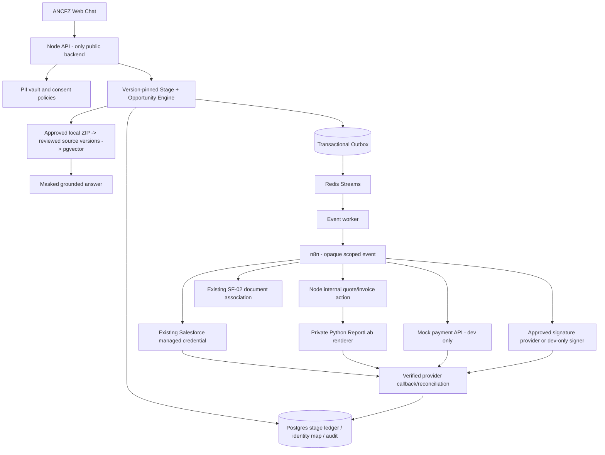

# ANCFZ Dedicated Agent — architecture and separation policy

Status: TARGET ARCHITECTURE / REQUIRES MAIN-BRANCH INTEGRATION; not implemented by this package.

## Product definition

This deployment is a **dedicated ANCFZ customer-assistant and business onboarding application**. It is **not** an open multi-organization SaaS product. ANCFZ alone controls the published catalog, source corpus, company persona, approved workflows and provider mappings. Retain internal `tenant_id` constraints, RLS/authorization filters, per-session pinning and security tests: an application can be single-client without removing security partition keys. Existing `anc-test` is a sandbox slug; rename/change it only with a verified migration, not by textual replacement across code.

## Trust and execution sequence

## Seven-stage authoritative ledger

| Order | Stage | Guard | Evidence to mark COMPLETE |
|---|---|---|---|
| 1 | Lead Generation | contact and permission | internal lead persisted, remote Lead only if verified |
| 2 | Qualification | catalog rules / documented scoring | qualification evidence persisted with provenance |
| 3 | Account | qualified lead and scoped conversion approval | real Salesforce Lead/Account/Contact/Opportunity verified |
| 4 | Package | approved current package and price | immutable quote and confirmed selection tied to opportunity |
| 5 | Documents | published conditional requirements and consent | OCR reviewed + Salesforce attachment acknowledged |
| 6 | Invoice / Payment | approved quote, documents and billing metadata | invoice PDF SHA, mock payment state `mock_paid` in dev; never real paid |
| 7 | Contract | required predecessors and approved template | provider-verified signed state + signed file evidence |

## Component contracts

- Catalog workbook `BusinessStages` is an implementation extension. Existing main parser ignores it; adding its strict parser and authoritative gate evaluator is required before publishing a catalog that uses it.
- n8n workflow exports under `infra/n8n/workflows/ANC*` are intentionally inactive. They require Node internal `/api/v1/internal/ancfz/lifecycle/*` endpoints and authenticated binding before import activation.
- Salesforce credentials already in n8n MUST be **reused by credential selection in the n8n UI**, not exported, echoed, committed, or replicated into a new file. Never configure a fallback hardcoded token. Test sandbox scopes and expiry; never switch to production without a documented change.
- PDF generation uses private server-passed approved price/line item details; the sample script deliberately only renders `mode=MOCK` until production approval is implemented in Node.
- Payment mock API has independent local key, accepts no card data and cannot actually charge. Mark every output `mock: true`; payment complete is **not** contractual proof of real funds. In production, separate adapter and state field are mandatory.
- Quote/invoice issue *must* be idempotent on `(tenant,opportunity,stage,revision,action)` and produce content SHA plus artifact reference, never rely only on n8n HTTP success.
- Contract signing cannot be claimed complete from draft creation, URL generation, sandbox smoke or `HTTP 200`.

## Mandatory invariants

1. Never auto-create a Salesforce Account from an unqualified Lead.
2. Never skip the stage order even if the visitor asks a later-stage question; answer permitted facts but keep pending requirements.
3. Ask one question at a time. Preserve active prompt, slot provenance, correction history and catalog version through RAG interruptions and multiple sessions.
4. `202 Accepted`, n8n success, `mock_paid`, document upload success and signed URL are not interchangeable with real provider completion.
5. Do not weaken auth, user consent, PII masking, private source visibility, audit, callback replay defenses or dead-letter reconciliation when simplifying the product.
