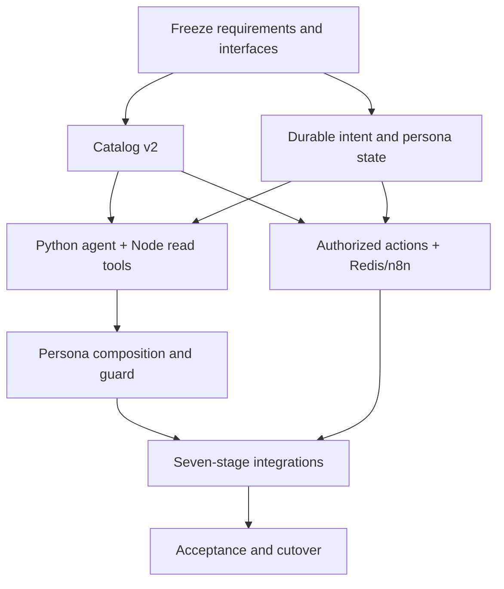

# Conversation Engine v2 — implementation roadmap, dependencies and release gates

**Status: PLANNED; no implementation tasks are marked complete in this document.** The preexisting Python gateway and Node adapter are unvalidated scaffolding. This is the execution blueprint for the new architecture, not an instruction to delete all legacy code at once. Source of truth: [architecture](conversation-engine-architecture.md), [contracts](conversation-engine-contracts.md), [evaluations](conversation-engine-evaluation.md).

## Target and non-negotiable gates

Build a tenant-configurable **Python Conversation Agent Runtime** with logical planning/intent, natural persona composition and a bounded Node tool-calling loop; **Node owns** session/intent persistence, deterministic policy/response guard and secure tools; **PostgreSQL owns** durable decisions; **Redis Streams + n8n** execute confirmed asynchronous actions.

ANCFZ must support **discovery + exactly seven ordered fulfillment stages** for one confirmed company-formation goal. At every eligible customer turn: natural named tenant persona, evidence-backed answer, one relevant follow-up when appropriate, no repeated questions, no unverified provider completion. Lead capture is not the universal business goal.

Every phase must record code paths, migration IDs, test commands/result, status (`PASS`, `FAIL`, `BLOCKED`, `NOT RUN`), rollback instructions and known external dependencies. No 25-commit/200-message milestone.

## P0 — Baseline, interfaces and catalog freeze (blocks all runtime work)

**Scope**
1. Freeze the seven-component architecture, typed TurnEnvelope, planner result, Node tool request/result, PersonaComposedResponse and Response Guard verdict. Agree one source of schema truth plus contract tests and strict error mapping.
2. Freeze the **v2 workbook schema**: required/optional import sheets, stable goal/category/intent/stage/tool keys, requirement stage ownership, persona policies, weighting bounds, dependency and fallback rules. Specify importer v1.4 → v2 backward compatibility and invalid workbook rejection.
3. Decide **model runtime capacity**: Azure deployment name, quota and supported Responses/tool schema, retries (initial + up to 3 transient retries per model call), shared budget, latency targets after measurement.
4. Inspect published ANCFZ catalog and four existing n8n webhook-test contracts; identify exact missing provider operations and sandbox-safe verification methods.
5. Capture clean `main` baseline and current Node API/CI/DB/Redis behavior. Classify old files as `retain`, `replace`, `delete-after-proven` and `history-only`, without deleting applied migrations/customer state.
6. Establish review sign-off of model actions vs safe Node tools, PII boundaries, authoritative stage completion and whether company registration itself is provider-verifiable at the final outcome.

**Exit:** approved v2 schema, invalid/valid sample catalog fixtures, tool/response JSON schema fixtures, dependency matrix and test plan. **If unclear, do not start an irreversible runtime cutover.**

## P1 — Catalog importer, shared contracts and Admin publication

**Changes**
- Extend `tools/ingestion/ingestion/intent_catalog.py` parser and tests to import all v2 sheets. Preserve six legacy mandatory sheets or make a documented versioned import migration.
- Update TypeScript `services/api/src/intent-catalog.ts`, API types, XLSX import/export/preview and Angular Admin validations. Do not silently discard unknown executable sheets, stage dependencies or workflow safety policy.
- Publish immutable per-tenant catalog versions and persona versions. Explicitly distinguish `knowledge_only` from confirmed Business Goal, and action tool from intent.
- Add static lints for orphan tools, inactive providers, stage requirement leakage, unsupported token/weight/schema types and forbidden ANCFZ hardcoding. Build approved synthetic catalog fixtures.

**Exit tests:** round-trip importer/exporter, catalog version-pinning, cross-tenant isolation, seven ANCFZ stages ordered, no later-stage document blocker on Stage 1, invalid workbook error diagnostics, inactive remote binding fails closed.

## P2 — Durable Session / User Intent Document

**Changes**
- Add forward-only PostgreSQL migration for per-session/opportunity projection and per-turn append-only assessment, with pinned catalogVersionId and personaVersionId, validated facts, intent evidence and pending question, stage state and status references.
- CAS/transaction boundaries follow existing session-first lock order; preserve existing `conversation_state`, `journey_instances`, `journey_facts`, action/document/outbox records and current public endpoints.
- Implement idempotent message/replay semantics and bounded summary patch validation. Redis caching keyed by tenant/session/opportunity/version/revision; invalidation on fact correction, consent, stage callback, catalog/source change and persona version migration.
- Design a **safe discovery record** before an opportunity exists; create opportunity only after confirmed business goal under published policy.

**Exit tests:** duplicate clientMessageId zero model/side effects, same ID different body conflict, restart continuity, parallel turn CAS, model response stale discard, new opportunity not inheriting old confirmation, persona pin persists, Redis outage not losing approved actions.

## P3 — Python agent planner and trusted Node read tools

**Changes**
- Evolve private `services/model-gateway` from one-shot `/plan` scaffold to a bounded orchestrator: initial model planning, tool-call extraction/validation, Node private tool calls, function-call output correlation, planner continuation, final structured plan.
- Implement Node read gateway for `get_conversation_context`, `get_persona`, `get_intent_catalog`, `get_journey_state`, `get_missing_requirements`, `search_knowledge`, `get_available_packages`, `get_action_status`. Re-derive scope and ACL from Node authentication, not model-supplied tenant refs.
- Reuse existing pgvector retrieval and catalog signal/requirement logic where correct. Support approved provider/package results with traceable evidence IDs.
- Apply model budget, tool round/call caps, PII minimization, singleflight/replay, prompt-injection isolation and typed fallback on unavailable tools. Integrate candidate goal/turn categories and Node-accepted scoring policy.
- Ensure **no tool call can directly create a Lead, charge, upload, send OTP or sign**. Writes follow P5.

**Exit tests:** user asks knowledge question → model requests approved RAG → consumes verified evidence → returns plan retaining goal and selecting missing requirement; tool injection/unknown tool/tenant spoof/stale revision fail closed; model 429/timeout and no-RAG cases use safe reply.

## P4 — Natural Persona Composer and Node Response Guard

**Changes**
- Pass published persona envelope before the first Python model planning call. Add final Persona Response Composer *after* tool continuation: natural coherent answer, evidence refs, one high-value question when appropriate, no internal fields.
- Introduce Node Response Guard for tenant/persona pin, language, structured provider facts and source citations, source revocation, question scope/uniqueness, forbidden metadata and unsupported material claims. Do not claim that regex or citation IDs semantically verify all prose.
- Add claim-level support checks for consequential fees/policies; fallback to approved factual phrasing/abstention/handoff when provenance is insufficient.
- Provide versioned approved **offline** persona templates for model, RAG, queue, reconciliation, unavailable action and consent rejection, evaluated by the same response guard. Never hardcode Zara into generic services.
- Refactor the Node chat API to delegate the new turn coordinator, preserving public response/identity/action routes. Gate rollout behind a controlled provider flag and traffic/tenant rollback.

**Exit tests:** every eligible message including errors sounds like the published tenant assistant; second tenant with different name/language; no raw JSON/tool/error; one relevant question or justified none; provider pending accurately described; no ungrounded pricing.

## P5 — Catalog-triggered approved writes and Redis events

**Changes**
- Node accepts Python action proposals as untrusted keys. Validate published ToolBinding, correct goal/stage/requirements, explicit goal confirmation, action-specific consent/confirmation and idempotency.
- Preserve existing `ActionRequest`, transactional outbox, Redis Streams, worker processing, authenticated n8n registry and provider callbacks. No direct model-provided URL or Python/LLM-to-CRM network call.
- Define provider outcome levels: transport accepted, n8n dispatched, provider write accepted, provider record independently verified, stage completed. Ambiguous provider writes enter reconciliation with no blind retry.
- Use separate auth/key refs; rotate previously disclosed OTP key and validate webhook contract and n8n production endpoints before activation.

**Exit tests:** no action without consent, no repeat charge/write, callback exact correlation and opportunity/stage revision, n8n timeout reconciliation, duplicate/late callback idempotence, no document attach to wrong Salesforce record.

## P6 — ANCFZ seven-stage provider adapters and verified chain

| Gate | Required data and verified evidence | Known dependency |
| --- | --- | --- |
| Discovery | Grounded Q&A; explicit goal confirmation if moving into a new journey | No compulsory CRM |
| 1 Lead Generation | Verified Lead ID plus purpose-specific consent and idempotent create/dedupe | Existing Lead test webhook unverified; prior `reconcile_required` |
| 2 Qualification | Stage-scoped activity/visa/eligibility facts with deterministic verdict | Catalog rules and fact provenance |
| 3 Account Creation | Verified Lead and OTP, specific action consent, actual linked Account/Contact/Opportunity provider IDs | OTP send/verify exist as reported; **Account create/link missing** |
| 4 Package Selection | Approved package eligibility, price provenance, confirmed selection/quote | Quotation adapter/status not verified |
| 5 Document Upload | Required document policy, customer consent, secure upload/OCR/review, SF-02 association verified | SF-02 test webhook reported, association not proven |
| 6 Payment Details & Invoice | Quote-linked verified invoice plus separate mock/real payment status | Mock PDF/payment ≠ real settlement |
| 7 Contract | Approved template/provider state and verified signed status when claimed | Signing provider/callback incomplete |

**Exit:** all seven stages in one synthetic sandbox session, with each provider evidence tier recorded; or truthful blocker state without skipped stage. "Company registered" is only allowed when actual authoritative company-registration proof exists, not solely CRM workflow completion.

## P7 — Integration acceptance, performance and cutover

1. Run [evaluation suite](conversation-engine-evaluation.md): persona, grounding, intent, tool limits, security, latency, restart, contract compatibility and all stage gates.
2. Record each test: exact build/commit, fixture, model version, catalog/persona versions, simulated/real provider label, evidence refs, latency and verdict.
3. Run API/UI/DB/Redis/Docker/CI suites. Verify Azure 429 response handling, shared turn deadline, cost/rate guard, source revocation and startup with/without Python overlay.
4. Stage behind feature flag for the acceptance tenant, do not change other tenants. Prepare rollback to prior stable Node route with data compatibility, no history deletion, and operator reconciliation for in-flight writes.
5. Only after real provider acceptance and security sign-off consider deleting legacy `app.ts` lead-first branches and old model compatibility shims. Removing historical SQL migrations or user data is prohibited.

**Exit:** the exact provider-verified, simulated or blocked category from [acceptance](acceptance.md), not "it worked" without evidence.

## Workstream dependencies

## Definition of Done, per feature

- [ ] Unit tests plus negative tests for unauthorized/malformed/model output.
- [ ] Node↔Python typed contract and runtime input validation.
- [ ] No cross-tenant/published catalog or persona bleed; PII minimization.
- [ ] Every customer response in pinned persona; appropriate one question/exceptions; grounding claim verification.
- [ ] Durable idempotency, CAS, replay and callback reconciliation.
- [ ] Measured model calls, latency, retries, token/cost and test failure logs.
- [ ] Updated docs/current-state and verification evidence (`IMPLEMENTED`, `TESTED`, `BLOCKED`).
- [ ] No real Salesforce write, charges, signatures or published webhook activation without explicit authorization and sandbox setup.

## Implementation limitations and open external decisions

- Azure deployment quota/latency/schema support and cost are not yet measured. Multiple model/tool rounds cannot provide deterministic response-time or 100% factual reliability guarantees.
- Source quality and citation coverage constrain RAG answers; stale data or unsupported pricing must be withheld.
- Provider adapters and authoritative callbacks for Account creation, quotations, invoice and contract are not supplied/verified.
- User-supplied n8n routes are `/webhook-test/`, which requires an active test listener; they are not production-ready endpoints.
- Document OCR/security and identity data need approved storage/retention and human review paths.
- Exact company registration completion cannot be inferred from CRM artifacts; identify official formation approval evidence.
- Catalog v2 and persisted schema must be approved and implemented before the sample workbook is executable.

**Recommendation:** proceed with P0 → P1/P2, then Python agent tools and persona guard, followed by workflows and integration acceptance. Do not jump from the initial model adapter directly into seven-stage side effects.
