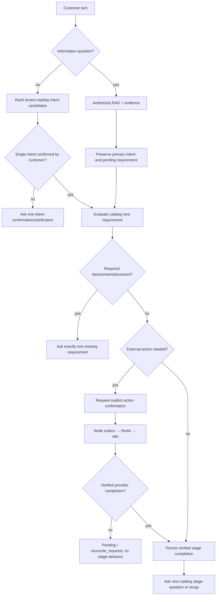

# Journey runtime — seven-stage ANCFZ acceptance, reusable tenant engine

**Status: TARGET.** Generic Node engine operates entirely on tenant-published catalog requirements and stage transitions. The ANCFZ seven-stage sequence is **data**, not a switch over the tenant slug.

## Per-response conversation invariant

For **each successful grounded response during an active journey**, the assistant provides a natural answer with approved citation(s), then **one relevant next question** derived from the durable pending requirement. If a knowledge question interrupts the flow, answer it and re-ask **only the still-unanswered requirement** using natural wording; do not repeat already fulfilled fields. If an intent has not been confirmed, ask confirmation before starting its gated workflow requirements. Exceptions: customer refusal/handoff, unavailable provider/error, explicit close and terminally completed journey; give a truthful status and an optional helpful next step, never manufacture a required question.

## Journey state machine

## Seven ANCFZ business stages

| # | Stage | Configurable requirement/gate | Real completion evidence |
| --- | --- | --- | --- |
| 1 | Lead Generation | User wants company setup; contact/consent per published catalog; intent and separate action confirmed | Salesforce remote Lead ID and verified Node callback |
| 2 | Lead Qualification | Catalog-required business activity/entity/visas/timeline/budget/other facts, policy-driven determination | Persisted qualifying decision, provenance and verified prerequisite state |
| 3 | Account Creation | Qualified Lead; verification and action confirmation | Correct Lead→Account/Contact/Opportunity associations and remote IDs |
| 4 | Package Selection | Approved package eligibility, authoritative pricebook and quote, customer confirmation | Confirmed selected package/quote revision |
| 5 | Document Upload | Separate consent, secure files, approved document requirements and OCR/review, existing SF-02 workflow | Verified document processing plus Salesforce attachment |
| 6 | Payment Details & Invoice | Verified quote, billing info, invoice creation, payment handling rules | Verified invoice artifact/reference; separately typed real or mock payment status |
| 7 | Contract | Prerequisite invoice and approved template, customer confirmation, provider operation | Contract reference and **verified signature proof** when representing signed status |

Stage 3 never auto-runs for every Lead and is not postponed to quote acceptance. Stage 5 includes SF-02. Stage 6 never treats mock payment as settled. The engine must not falsely mark later stages complete from conversation text.

## Detailed continuous example (synthetic, illustrative)

1. Customer asks to start a company. Node presents the top single catalog intent with one confirmation question. User confirms that *intent*.
2. Collect one missing Lead requirement at a time; validated contact and purpose-specific consent; issue separate Lead action confirmation; send via outbox/n8n; wait for verified Salesforce Lead before advancing.
3. Qualification asks only missing catalog facts, answering interruptions through RAG with citations + the pending follow-up; correcting visas/budget recomputes dependent facts/proposals.
4. Qualified customer explicitly approves Account Creation and identity verification if required; verified CRM result advances stage.
5. Package discovery uses approved RAG/catalog and a confirmed quote, then collects only catalog-required documents securely through OCR/SF-02, invoice/payment, and contract.
6. Final summary lists provider-verified records and any pending tasks. At every step, preserve **same session and active opportunity** until the intended journey terminates.

## Interruption and external callback invariants

- For knowledge-only turns, do not reset intent or advance stage merely because an answer is provided.
- A callback is validated against tenant, opportunity, stage revision, action ID/idempotency key, external correlation and provider state; mismatches reject or reconcile.
- Failed/pending n8n does not change "completed" status. The assistant may discuss next steps but cannot skip the blocked gate.
- New intent switch requires confirmation and distinct opportunity identity. Prior consent, action and document identities cannot be reused.
- Restart uses persisted User Intent Document and message history, not Foundry conversation state or Redis.
- No fixed 25/200 message count. The test completes when all seven gates are verified, or reports the precise blocking provider.
