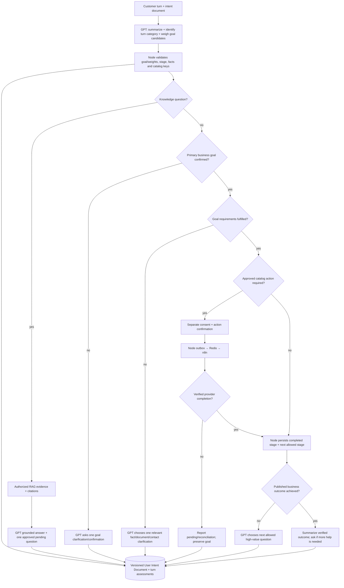

# Journey runtime — seven-stage ANCFZ acceptance, reusable tenant engine

**Status: TARGET.** The **GPT planner drives conversation**, using the current User Intent Document and tenant-published catalog to decide what to do next. Node authorizes and persists business state. The seven ANCFZ stages are the **fulfillment plan for a confirmed company-formation goal**, not seven unrelated primary intents or a universal journey for every visitor. Other tenants/goals use their own catalog paths. Read [intent taxonomy](intent-taxonomy.md) and [conversation planner](conversation-planner.md).

**Canonical stage contract:** [conversation-engine-contracts.md](conversation-engine-contracts.md) and [P6 provider integration gates](conversation-engine-delivery-plan.md). The seven ANCFZ stages belong to the tenant's published business-goal policy, not universal hardcoded Node conditions. **Discovery is a pre-stage**: grounded knowledge visits need no Lead creation. Once the company-formation goal is explicitly confirmed, each stage advances only after its own requirements and authorized provider evidence—not after the model narrates success.

Every current-stage RAG answer, pending update, contact request, OTP prompt, document step and contract response must be delivered in the pinned tenant persona through the Node guard. A knowledge interruption or correction must not reset intent, repeat verified facts or bypass consent. Use [evaluation matrix](conversation-engine-evaluation.md) to prove behavior.

## Per-response conversation invariant

On each meaningful turn, GPT should **understand the running conversation summary**, classify the turn intent (knowledge/requirement/status/navigation/execution), evaluate business goal confidence and requirement gaps, and choose the best next move based on **current catalog definitions**, not a fixed lead-capture script.

For each active-journey **grounded factual answer**, answer using approved tenant RAG citations or verified structured provider/catalog facts and append **one useful question** that reduces remaining goal uncertainty or fulfills the highest-priority unmet requirement. Select the question through the LLM planner, validate it against the published catalog and stored facts in Node. **Do not repeat** already answered questions.

The LLM may choose clarification, company activity, eligibility, document upload, personal/contact details, quote approval or workflow confirmation **only when that requirement belongs to the customer's confirmed business goal and the current stage**. It must not request identity data to force a CRM Lead.

When the **customer goal itself** is satisfied, stop requirement collection and ask **"Is there anything else I can help you with?"** For knowledge-only visitors, answer the question and offer related help; never force business setup or lead creation. Do not add artificial questions to a refusal, farewell, handoff, blocked/error response or an external pending state where no permitted next action exists.

## Persona continuity through seven stages

One new-company journey is experienced as **one continuing conversation with the tenant's named AI advisor**, not seven separate technical forms. ANCFZ uses **Zara only when the session has selected a published Zara persona**; never hardcode that name for other tenants.

Python must understand the conversation summary and active goal, call approved Node tools for missing facts/RAG/status before replying, and **compose every customer-visible message** naturally in the pinned voice: knowledge response, clarification, consent, Lead/Account request, package recommendation, document question, invoice status, contract status, error, human handoff and completion. Node Response Guard checks truthfulness, citations, appropriate question and metadata non-leakage.

- Explain a verified pending action in plain language, not `reconcile_required`, provider IDs or raw n8n responses.
- Avoid repeated "I'm Zara" introductions and asking facts already provided.
- Never say a customer is registered, paid or signed unless the authoritative provider confirms it.
- If sources or GPT fail, send an approved tenant-persona fallback rather than fabricated facts or arbitrary CRM collection.
- Respect one relevant question except opt-out, farewell, terminal error or a state where there is no legitimate next step.

These are **release-blocking acceptance gates**. See [persona-response-contract.md](persona-response-contract.md).

## Journey state machine

A **knowledge subintent** never resets the confirmed business goal. A **service-execution subintent** proposes only approved catalog operations; it is not automatically the customer's goal. A callback supplies authoritative stage completion, not GPT's interpretation of success.

## Seven ANCFZ business stages

| # | Stage | Configurable requirement/gate | Real completion evidence |
| --- | --- | --- | --- |
| 1 | Lead Generation | User wants company setup; contact/consent per published catalog; intent and separate action confirmed | Salesforce remote Lead ID and verified Node callback |
| 2 | Lead Qualification | Catalog-required business activity/entity/visas/timeline/budget/other facts, policy-driven determination | Persisted qualifying decision, provenance and verified prerequisite state |
| 3 | Account Creation | Qualified Lead; verification and action confirmation | Correct Lead→Account/Contact/Opportunity associations and remote IDs |
| 4 | Package Selection | Approved package eligibility, authoritative pricebook and quote, customer confirmation | Confirmed selected package/quote revision |
| 5 | Document Upload | Separate consent, secure files, approved document requirements and OCR/review, existing SF-02 workflow | Verified document processing plus Salesforce attachment |
| 6 | Payment Details & Invoice | Verified quote, billing info, invoice creation, payment handling rules | Verified invoice artifact/reference; separately typed real or mock payment status |
| 7 | Contract | Prerequisite invoice and approved template, customer confirmation, provider operation | Contract reference and **verified signature proof** when representing signed status |

Stage 3 never auto-runs for every Lead and is not postponed to quote acceptance. Stage 5 includes SF-02. Stage 6 never treats mock payment as settled. The engine must not falsely mark later stages complete from conversation text.

## Detailed continuous example (synthetic, illustrative)

1. Customer asks to start a company. GPT weighs the catalog's Business Goal candidates using the conversation summary and asks one natural confirmation of the **company-formation goal**; the customer confirms. No CRM action is implied by that confirmation.
2. Collect one missing Lead requirement at a time; validated contact and purpose-specific consent; issue separate Lead action confirmation; send via outbox/n8n; wait for verified Salesforce Lead before advancing.
3. Qualification asks only missing catalog facts, answering interruptions through RAG with citations + the pending follow-up; correcting visas/budget recomputes dependent facts/proposals.
4. Qualified customer explicitly approves Account Creation and identity verification if required; verified CRM result advances stage.
5. Package discovery uses approved RAG/catalog and a confirmed quote, then collects only catalog-required documents securely through OCR/SF-02, invoice/payment, and contract.
6. When the published company-formation goal actually reaches its verified outcome, GPT summarizes completed work and asks **if the customer needs any more help**. On knowledge-only sessions, use the same courteous follow-up without forcing a Lead. At every step preserve **same session and active opportunity** until the intended goal terminates.

## Interruption and external callback invariants

- For knowledge-only turns, do not reset intent or advance stage merely because an answer is provided.
- A callback is validated against tenant, opportunity, stage revision, action ID/idempotency key, external correlation and provider state; mismatches reject or reconcile.
- Failed/pending n8n does not change "completed" status. The assistant may discuss next steps but cannot skip the blocked gate.
- New intent switch requires confirmation and distinct opportunity identity. Prior consent, action and document identities cannot be reused.
- Restart uses persisted User Intent Document and message history, not Foundry conversation state or Redis.
- No fixed 25/200 message count. The test completes when all seven gates are verified, or reports the precise blocking provider.
