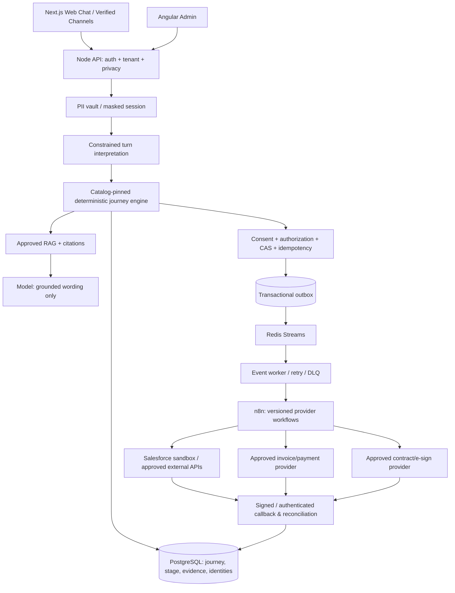

# ANCFZ Seven-Stage Customer Lifecycle — Implementation & Acceptance Plan

Status: PLANNED / NOT ACCEPTED. Prepared 2026-10-28. **Plan is not implementation evidence.**

Repository: `sanukhandev/agentic-rag-ai`
Reviewed main: `c4a807c60801fe66cdb34199d1cb9aaee86a9409` (2026-10-27).
New branch: `feat/ancfz-seven-stage-lifecycle-acceptance`, created from `main`.
Implementation branch publication rule: **do not push any implementation commits until at least 25 substantive, locally verified commits exist**. This plan is delivered separately so it does not bypass that rule.

## A. Scope, governing decisions, and truth rules

Deliver ONE persistent, tenant-scoped, opportunity-scoped, source-grounded visitor conversation covering these exact business stages, in order:

1. **Lead Generation** — capture name, email, phone, and approved optional personal/business attributes (nationality only if purpose/authority and data minimization allow); record stage-scoped consent. Create an internal lead draft; do not silently create Salesforce Account.
2. **Lead Qualification** — collect visa type (when relevant), entity type, business activity, budget (when relevant), timeline, requirements and verified qualification/eligibility signals. Apply published catalog rules, rather than an LLM-invented threshold. CRM Lead sync is allowed only after the existing contact+consent+workflow gates; mark remote Lead success only after independently verified Salesforce result.
3. **Account Creation** — ONLY after successful qualification: reconcile or convert the existing Salesforce Lead to Account + Contact and associate an Opportunity. Persist independently verified IDs and the matching local opportunity ID. Duplicate checking and already-converted paths must be idempotent. Do not create an Account for every inquiry or defer conversion until package acceptance.
4. **Package Selection** — retrieve tenant-approved, currently effective offerings and conditions; produce a server-approved quote; confirm exactly one selected offer revision. No fabricated prices, fees, validity, promotions, or package eligibility.
5. **Document Upload** — follow approved catalog document requirements, one document per requested step. Consent, private upload, type/size checks, malware policy, OCR, provenance, review/confirmation, and CRM association to the appropriate Lead/Account/Opportunity/Contract. Integrate the *existing* SF-02 Salesforce Document Upload if present in configured n8n; don't duplicate it blindly. DOC-01 OCR is distinct from CRM attachment.
6. **Payment Details & Invoice** — collect only appropriate billing metadata (legal name, address, tax fields when required); never request/store payment card numbers, CVV, bank passwords or raw credentials in chat. Generate invoice using an approved provider/system and authoritative accepted quote; persist verified invoice ID, amount, currency, line items and state. Payment collection (if required) must use a secure hosted provider link/token, with verified provider callback and reconciliation; do not equate invoice issuance with payment.
7. **Contract** — select approved template and parties, verify prerequisites, create/send through approved provider, track delivery/signing and record signed artifact and verified signature status. Creating a draft or sending an e-sign URL is not contract completion.

Journey must handle 25+ user messages in **one session** without context loss, plus state replay, restart, interruption by RAG questions, corrections, changed intents, declined consent, duplicate messages, simultaneous messages and delayed callbacks. One relevant next question at a time. Knowledge can be answered only from approved active tenant sources and verifiable citations. Unknown values receive contextual abstention or human handoff.

**Authority boundaries**:
- Node API + PostgreSQL: tenant isolation, state machine, stage/consent policy, field validation, conversation continuity, idempotency, auditing, action outbox, provider result verification.
- Published, version-pinned tenant catalog: intent detection, stage requirements, conditional slots, prompts, transitions, workflow keys, approved document types, minimum qualifications, package/CRM mapping references. Catalog is data; it cannot grant unauthorized tool execution.
- RAG: approved tenant facts and source provenance; no LLM-generated pricing, compliance or promises.
- LLM: constrained turn interpretation, factual answer phrasing and read-only tool proposals; never direct state transitions, external writes or secret access.
- Existing PostgreSQL outbox -> Redis Streams -> worker -> n8n: async authorized execution and status callbacks. Do not restore direct model-to-n8n or browser-to-provider calls.
- n8n: scoped provider adapters with managed credentials and redacted execution data. Credentials remain in n8n credential store and server-side secret manager; no secrets committed to Git.
- Salesforce / approved provider: external source of truth for external ID and completion. Locally fabricated IDs, HTTP 202 and n8n execution success are not external success.
- User/tenant consent remains action-specific. Broad developer approval does not authorize personal-data disclosure or committing real invoices/signatures without customer confirmation.

## B. Verified baseline and risks

Main tree has Node/Express/TypeScript API, Next.js web, Angular admin, PostgreSQL/pgvector, Redis, Python ingestion/OCR, configurable intent-catalog upload and publish, source-grounded RAG, PII masking, chat state, protected actions/outbox, n8n templates and local test commands. Relevant files:

- `AGENTS.md` (contains stale 15 October repo-reality paragraph; update with current truth)
- `services/api/src/app.ts`, `types.ts`, `conversation-state.ts`, `intent-journey.ts`, `intent-catalog.ts`, `intent-catalog-xlsx.ts`, `actions.ts`, `event-worker.ts`, `store-postgres.ts`, `store-memory.ts`
- `infra/postgres/028-043*.sql`; `infra/n8n/workflows/01-04*`, `CRM01*`, `CRM02*`, `CRM03*`, `DOC01*`, `INTENTancfzint*`
- `docs/02-system-architecture.md`, `07-n8n-orchestration.md`, `20-intent-catalog.md`, `conversation-state-contract.md`, `crm-qualification-and-reconciliation.md`, `continuous-lead-conversation-plan.md`, `17-acceptance-test-matrix.md`, `implementation/*`
- `artifacts/anc-test/ANCFZ_Intent_Catalog_Updated.xlsx`, existing template generators and README.

Existing evidence: baseline docs report prior local lead/OCR success, but that evidence is historical and not proof of the present live sandbox. `CRM02ContactUpsert.json` is explicitly an **inactive template** with a missing approved provider step. `03-anc-lead-capture-wf-1.json` contains an older env-dependent flow; inspect actual registered workflows and migrate toward managed credentials and uniform callback contracts. Some generated workflows are inactive by design.

**PR #71** (`feat/catalog-driven-journey-orchestration`) is OPEN against main and contains major potentially reusable work: scoped journey identities, typed tools, business lifecycle models, migrations 044-052, account conversion and invoice/contract n8n templates, and an API conversation harness. Its own verification notes report 8 scenarios / 205 turns and explicitly unverified remote Salesforce Account conversion, invoice and contract provider completion, and independent external OCR. The lead path had `reconcile_required` evidence. Treat these as **partially implemented candidates, not completed main functionality**. Do a file-by-file delta review and integrate good portions onto the new branch; avoid parallel conflicting implementations and do not merge PR #71 or #69 blindly.

Before implementation: verify actual latest `main` SHA, compare with PR #71/#69, capture an API/DB/environment inventory, review unresolved PR comments and any branch-divergence/race fixes. If main advanced, rebase new work carefully and update this evidence ledger.

## C. Target architecture

### Persistent business objects and invariants

- `journeyId` / `opportunityId`: stable per independently actionable opportunity, not per webhook or chat message.
- `stage`: one enum, e.g. `lead_generation`, `lead_qualification`, `account_creation`, `package_selection`, `document_upload`, `billing_invoice`, `contract`; separate `status`: `not_started`, `awaiting_customer`, `awaiting_consent`, `ready`, `queued`, `processing`, `completed`, `failed`, `reconcile_required`, `human_review`.
- `catalogVersionId`: pinned for ongoing journey; new publication affects new journeys, with explicit audited migration path if truly needed.
- `stage_revision`, `journey_revision` and `state_version`: CAS/fencing protects against concurrent chat turns and out-of-order callbacks.
- `requiredSlots`, `validatedFacts`, `provenance`, `pendingPrompt`, `consentPurpose`, `consentRevision`, `nextRequirementKey`, `externalOperation` and `blockingReason`: persisted with bounded size, auditable history.
- `external_id_map`: tenant + provider + object type + external ID + local journey/action association; unique indexes stop cross-tenant/multi-action duplicates.
- `lead`, `account`, `contact`, `opportunity`, `quote`, `package_selection`, `document`, `invoice`, `payment_reference` (optional), `contract`: separate typed entities and lifecycle states. `leadId != accountId` and `invoiceCreated != paid`.
- Every side effect uses stable `(tenantId, journeyId, stageKey, actionKey, actionRevision)` idempotency, transactional state/outbox creation, verified callbacks and reconciliation after ambiguous timeouts.
- Stage completion is checked using authoritative preconditions and separately verified external result; do not trust LLM assertions, client flags, local placeholders or workflow acceptance.
- Fail closed on consent, permission, stale catalog, unsupported provider, missing credentials, unsigned callback, wrong tenant, missing external IDs and unsupported package prices.

### Stage dependency gates

| From -> To | Required gate | External proof |
|---|---|---|
| Lead generation -> qualification | Valid contact draft + scoped handling consent when storing/sharing PII | Internal record audit |
| Qualification -> account | Catalog-required qualification complete, score/policy threshold, CRM Lead consent, approved request | Verified Salesforce Lead and conversion eligibility |
| Account -> packages | Remote Account, Contact and linked Opportunity reconciled; correct tenant/journey | Verified Salesforce IDs (or explicit approved alternate account flow) |
| Packages -> documents | Eligible approved offer, current approved quote, explicit selection and commercial consent | Server-confirmed quote & selection |
| Documents -> invoice | Required docs processed, validated, accepted and appropriately attached in CRM | OCR evidence, attachment confirmation, no pending required docs |
| Invoice -> contract | Billing data validated, invoice issued and verified; enforce payment prerequisite only if published commercial rule requires it | Provider invoice ID; verified payment status if policy requires |
| Contract -> completed | Approved template, final parties, valid invoice/quote and verified signing outcome | Provider signature confirmation and immutable signed artifact reference |

## D. Phase-by-phase execution — exactly 25 substantial checkpoint commits (minimum)

No one should fabricate/empty-split commits to reach 25. These are natural units of code + tests + docs. Keep all commits LOCAL until **at least 25** exist and the gate is green; then push once. Preserve regular local commits for recovery. Record test commands and pass/fail for each checkpoint.

| Commit | Phase / atomic task | Required code + evidence |
|---:|---|---|
| 01 | P0 Baseline audit and compatibility map | Capture main/PR71/PR69 diff, feature/endpoint inventory, blocker matrix, reproducible baseline tests; `docs/verification/lifecycle-baseline.md` |
| 02 | P0 Architecture ADR and updated agent instructions | Update `AGENTS.md` stale claims, trust boundaries, `docs/02-system-architecture.md`, new lifecycle ADR and threat model |
| 03 | P1 Lifecycle domain contract | Typed seven-stage state machine, transition table, stage completion evidence types, pure validators and tests |
| 04 | P1 Catalog schema extension | Versioned stage definitions/requirements/transitions/conditional collection and stage-to-action bindings; backward compatibility |
| 05 | P1 Workbook parser + template | Update XLSX generator/parser, mandatory README/sheets preserved; lint/signals/references/roundtrip import/export tests |
| 06 | P1 ANCFZ draft workbook + review gate | ANCFZ-specific published-compatible workbook, reviewed business-source references, qualification matrix; no fabricated package data |
| 07 | P2 DB migration and persistence contracts | Additive versioned migrations for journeys, stage transitions, external CRM identities, invoice/contract refs, proper indexes; migration and rollback/rehearsal tests |
| 08 | P2 Deterministic journey reducer + CAS | Atomic stage advancement, pinned version, paused/resumed intent, corrections, stale update rejection; memory and PG parity tests |
| 09 | P2 Long conversation continuity | Chat API prompt routing, RAG interruptions, context limits, rolling summary, corrections, recovery, exactly one next question |
| 10 | P2 Durable action/outbox binding | Opportunity-aware action keys, idempotency, confirmation, Redis delivery, dead-letter/reconciliation and callback fencing |
| 11 | P3 Lead capture stage | Contact/nationality purpose control, validation, consent, internal draft, duplicate linking, no account; API negative tests |
| 12 | P3 Qualification stage | Catalog-driven activity/entity/visa/budget/timeline questions, score, eligibility and evidence, reject premature conversion |
| 13 | P4 Salesforce Lead identity + conversion adapter | Tenant-bound typed conversion contracts, read/lookup/upsert/convert/reconcile result schemas; verify external IDs; no secrets in code |
| 14 | P4 n8n account/contact/opportunity workflow | Small idempotent credential-backed workflow(s), sandbox duplicate/retry/partial failure reconciliation, signed callback and proof |
| 15 | P5 Package master and retrieval | Approved/effective packages, eligibility filters, source refs and no-price abstentions; no synthetic fee publication |
| 16 | P5 Quote and selection | Quote version/expiry/currency/amount validation, customer confirmation, one-selection semantics, change/requote tests |
| 17 | P6 Document intake/OCR strengthening | Requirement-key scoped upload, ordered documents, private storage, extraction provenance, replacement and late callback guards |
| 18 | P6 Salesforce SF-02 document association | Inventory/reuse existing SF-02 adapter, attach to correct entity after conversion, verify attachment ID, error and retry handling |
| 19 | P7 Invoice and payment status | Approved billing metadata + provider adapter, authoritative quote amounts, invoice proof and secure external payment link/status gates |
| 20 | P8 Contract creation/signing | Approved template/version, party/CRM linkage, provider draft/send/execute, signature callbacks and signed artifact evidence |
| 21 | P9 Cross-cutting security/reconciliation | Malicious callback, PII and consent tests, tenant crossing, workflow impersonation, out-of-order events, unknown completion, DLQ |
| 22 | P9 Admin stage controls | Tenant admin stage timeline, audit, catalog preview/publish, reconciliation queue, human review, statuses not misleading |
| 23 | P9 Web conversation UX | Resume/reset, one-question prompt, upload status, quote/consent controls, pending provider outcomes, accessible errors |
| 24 | P10 API acceptance harness | Real API >25-turn coherent session, 8 scenario/200+ turn pack, restart/replay/outage, A/B isolation, deterministic and sandbox modes |
| 25 | P10 Release evidence and final documentation | Update AGENTS/architecture/contract/OpenAPI/ER/n8n runbook, proof ledger, manual browser verification and exact PASS/BLOCKED verdict |

If changes need more than 25 commits, **continue locally**; 25 is a *minimum*, never an instruction to omit tests. If all 25 are present but acceptance fails, continue local remediation; **do not call the project complete**. If the environment or connector requires an early push to run CI, first determine if local test equivalents can satisfy the requirement; do not silently override the user push policy.

## E. Catalog / tenant configuration work

1. Preserve required import sheets: `README`, `Intents`, `Signals`, `Slots`, `Relations`, `WorkflowBindings`. Preserve existing optional `QualityRules`, `JourneyRequirements`, `JourneyTransitions`, `DocumentPolicies`, `DocumentSettings` etc. Do not break current upload and publication.
2. Introduce backward-compatible typed **stage metadata** (`LifecycleStages`, `StageRequirements`, `StageTransitions`, `StageWorkflowBindings`, `CrmObjectMappings`, `PackageEligibility`, `InvoicePolicies`, `ContractPolicies`) or equivalent normalized schema only after checking the existing catalog model; do not duplicate `JourneyRequirements` where it already suffices.
3. Treat entity type, visa type, nationality, budget, document type and billing data as conditional, source/intent-specific fields; requiredness must be explicit in catalog.
4. Stage binding examples: `crm.lead.create`, `crm.lead.qualify`, `crm.account.convert`, `crm.contact.reconcile`, `crm.opportunity.ensure`, `package.quote.create`, `document.ocr.process`, `crm.document.attach`, `billing.invoice.issue`, `billing.payment.verify` (optional), `legal.contract.prepare`, `legal.contract.signing.verify`. Registry must allowlist and enforce scopes; exact keys validated against repo and exported workflow identifiers.
5. Prices/eligibility terms belong in approved effective-dated package/pricebook records with source refs, **not in model prompts or sample generated catalog defaults**. Missing data = pending business review, not guessed amount.
6. Create a candidate `ANCFZ_Intent_Catalog_7_Stage_DRAFT.xlsx` and staged import test; do not publish without reviewed tenant approval and verified workflow registration.
7. Maintain existing `anc-test` behavior and legacy catalog compatibility; migration must not strand active sessions.

## F. n8n workflow matrix and configuration

| Workflow | Reuse/build? | Terminal contract |
|---|---|---|
| ANC Lead Capture WF-1 / CRM-02 | Reconcile and reuse existing; choose one canonical CRM Lead path | Verify Salesforce Lead identity or explicit reconcile_required; never both flows create duplicates |
| CRM-01 Contact Lookup | Reuse/extend | Tenant/provider-scoped lookup with deterministic match priority |
| CRM-03 Summary Sync | Reuse/extend | Approved redacted summary, authenticated update, scoped ID |
| Account Conversion WF | Evaluate PR #71 `05-anc-account-conversion-wf-1.json` and implement missing actual Salesforce conversion | Verified Account, Contact, Opportunity IDs and conversion state |
| DOC-01 OCR | Reuse | Worker-verified OCR result, provenance, correct requirement/version |
| SF-02 Salesforce Document Upload | Locate deployed existing workflow, integrate with DOC-01, export sanitized version if authorized | Verified Salesforce ContentDocument/ContentVersion or approved attachment ID associated to target object |
| Package/Quote Selection | Prefer Node transaction; use n8n only for external pricing/quote providers | Exact source/quote revision and external confirmation when applicable |
| Invoice WF | Evaluate PR #71 `06-anc-invoice-generation-wf-1.json`, supply real approved provider | Verified invoice ID and status, no fake completion |
| Payment Verify WF (conditional) | New only if supported policy requires payment | Verified event and provider ledger state, no raw card data |
| Contract WF | Evaluate PR #71 `07-anc-contract-preparation-wf-1.json`, supply approved contract provider | Verified draft/send AND separately verified signed completion |

Each workflow must: use managed n8n credentials; be inactive until validated; accept server-issued tenant, journey/opportunity, action, idempotency, event, correlation and attempt IDs; claim only matching action; use opaque/minimum data; redact logs; return signed callback; reconcile unknown/replayed outcomes; make no unverified success claim. Test n8n export imports and actual node execution in sandbox. Credential names/config keys can be documented, but not their values.

## G. Minimum API conversation: one continuous session (30 visitor turns)

Run by calling the actual `GET /api/v1/chat/config`, `POST /api/v1/chat/sessions`, `POST /api/v1/chat/messages` (confirm actual paths), consent/action and upload endpoints using unique `clientMessageId`s. No bypass by directly changing database or stage flags. Verify assistant response after EVERY turn, state and SQL invariants after relevant turns. Use synthetic identity and provider sandbox.

1. Hello.
2. I want to start a fashion boutique in the UAE.
3. What's the difference between the available setup types?
4. I prefer a free zone if eligible.
5. My business activity is fashion retail.
6. Is that activity allowed? (RAG evidence interruption.)
7. I want one shareholder.
8. I might need two visas.
9. Actually, only one visa for now. (Correction.)
10. My timeline is about two weeks.
11. Is that timeframe guaranteed? (Must avoid unsupported promise.)
12. My budget is within the catalog-defined range, if applicable.
13. Here's my name (synthetic data).
14. Here's my email (synthetic data).
15. Here's my phone (synthetic E.164 data).
16. I agree to the explicitly described lead contact purpose. (Recorded purpose-specific consent.)
17. Can you explain the next steps? (Grounded interruption.)
18. Yes, please qualify the request. (No auto Account before gate.)
19. Which package options fit these requirements?
20. Compare those packages using approved sources.
21. I choose package A only if its current verified quote is available.
22. Please confirm that quote/selection.
23. What documents do you need? (Only approved one-at-a-time.)
24. I can upload the requested document now. (Use real upload endpoint with safe synthetic file.)
25. Is my document processed and linked to the CRM record yet? (Must distinguish uploaded/OCR/attached.)
26. I'd like to confirm the next required document or ask for human review if OCR failed.
27. Use these synthetic invoicing company details, not payment card data.
28. Please issue an invoice for the approved quote, after my confirmation.
29. Has the invoice actually been issued? Is payment required before contract?
30. Please prepare the contract and tell me its verified signing status.

After turn 30, deliver the actual callback events under test, then send further turns if necessary to verify contract signed completion, restart/resume, and late callbacks. For a complete end-to-end success case, the environment MUST have supported Salesforce sandbox, invoice and contract providers with test identities; otherwise mark **EXTERNAL INTEGRATION BLOCKED** and do not fake green.

**Mandatory additional cases** (separate sessions; add >=8 scenarios and >=200 total visitor turns, reusing PR #71 harness if valid): greeting; intent synonyms/typos; 2 multi-intents and independent opportunity scopes; RAG vs stage interruption; blank/invalid contact; denied/revoked consent; tenant B isolation; stale catalog publication mid-session; simultaneous duplicate messages; provider timeout and manual reconciliation; duplicate Salesforce Lead/Account/Contact; OCR failure/late replacement; expired package price; invoice duplicate retry; contract draft vs signed event; replayed/forged webhook; server restart during Stage 5.

Verification must assert NOT ONLY assistant text, but database IDs, stage history, correct opportunity, action states and idempotency, no forbidden external calls, provider-issued external IDs, n8n correlation and replay/retry behavior. Record request/response metadata in **redacted** artifacts; never store customer PII or credentials in artifacts.

## H. Release quality gates and verdict

- Rebase check against latest main, separate review of PR #71/#69, schema history and application trust model.
- `npm ci`, `npm run typecheck`, `npm run lint`, `npm test`, `npm run build`, `npm run verify:compose`, `npm run verify:secrets`, `npm run verify:secrets:test`, `npm run db:migrate` and appropriate Python `unittest`/`pytest` runner as actually available.
- Real PostgreSQL migration + rollback/upgrade safety and integration suite with available host port; run DB in container network if `54329` is unavailable. Don't claim DB suite pass when skipped.
- n8n import/schema/inactive-by-default checks, actual sandbox execution and correlation/reconciliation cases; no secret leaks.
- Minimum **one session with >=25 customer messages and >=25 corresponding agent responses** over actual HTTP; eight scenarios and >=200 customer messages total recommended as an additional gate, not a replacement.
- Target behavior across seven stages with checked server state transitions, approved RAG evidence, CRM dedupe and lead conversion, package quote, document OCR + Salesforce attachment, invoice, contract signing.
- Web and admin browser acceptance including resumed chat, document UX, invoice/contract status and manual review.
- Final reports in `docs/verification/` include executed commands, environments, timings, redacted identifiers, exact PASS/FAIL/BLOCKED/SKIP matrix, screenshots and sandbox references if available.
- **DONE is allowed only if all mandatory API, data, security, browser, n8n and live sandbox/provider acceptance gates pass.** If provider credentials/actual approved packages/templates/remote APIs are absent, report `PARTIALLY VERIFIED — EXTERNAL INTEGRATIONS BLOCKED`; preserve local commits, do not push before 25, and never announce full completion.

## I. Operational guardrails and final publication

- Branch created from `main`, currently with no implementation content pushed. Put this file in `docs/plans/ANCFZ_SEVEN_STAGE_IMPLEMENTATION_PLAN.md` as the first *local* commit when coding starts.
- `git fetch`, compare latest `main`, `git switch feat/ancfz-seven-stage-lifecycle-acceptance`, work locally, commit each cohesive task. Do not amend/force-push away prior work or modify main directly.
- Work phase by phase, produce reproducible evidence and update the progress ledger at each checkpoint. Task completion requires code, migrations if needed, tests, docs and no regressions.
- Do **not** push after each phase. Once 25 or more substantial commits and all locally runnable quality gates are ready, `git push -u origin feat/ancfz-seven-stage-lifecycle-acceptance` (one intentional push). If CI reports failure, fix in further commits; push only after a further coherent validated batch agreed under the same policy.
- Open draft PR after permitted push, do not merge or deploy production automatically; change it to ready only after mandatory acceptance. Never use real production personal data for tests.
- Update `AGENTS.md` for current repo reality, `docs/02-system-architecture.md`, `docs/07-n8n-orchestration.md`, `docs/20-intent-catalog.md`, `docs/05-api-contracts.md`/OpenAPI, `docs/09-data-model.md`, ADRs, diagrams, runbooks, acceptance matrix and verification reports as each contract changes.